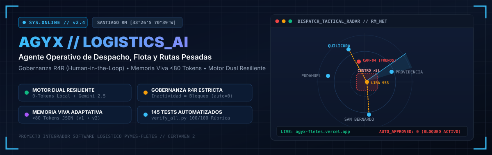
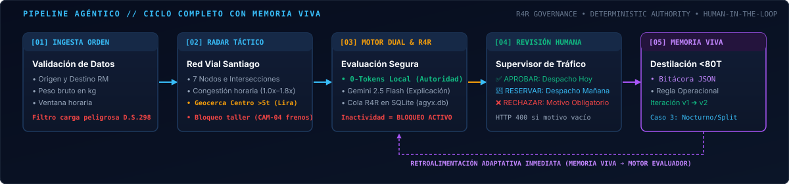
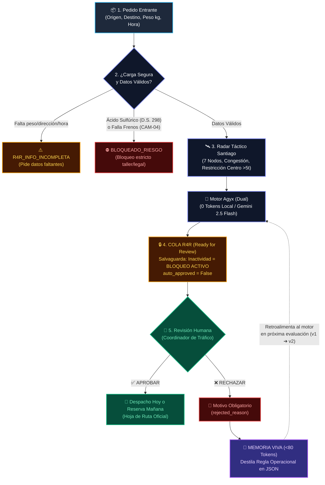
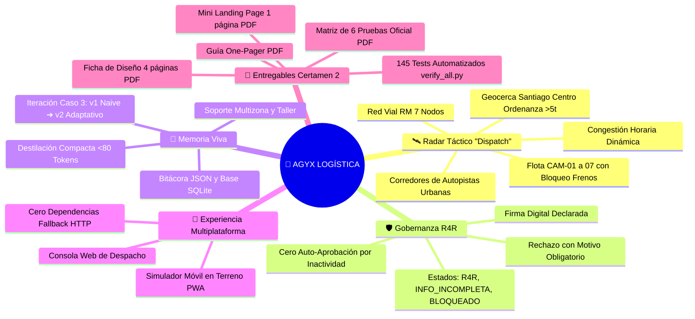

<p align="center">
  
</p>

<p align="center">
  <a href="https://agyx-fletes.vercel.app"></a>
  
  
  
  
</p>

<h3 align="center">
  <a href="https://agyx-fletes.vercel.app">▶ Abrir Centro de Comando en Vivo (Vercel)</a> &nbsp;•&nbsp;
  <a href="#-pipeline-agéntico-y-arquitectura-del-sistema">Pipeline Agéntico</a> &nbsp;•&nbsp;
  <a href="#-entregables-oficiales-del-certamen-2-entregables">Entregables PDF</a> &nbsp;•&nbsp;
  <a href="#-guía-de-ejecución-rápida-local">Quickstart</a>
</h3>

---

## ⚡ ¿Qué es Agyx?

**Agyx** es un agente operativo autónomo diseñado para resolver la toma de decisiones críticas de despacho, asignación de flota y planificación de rutas pesadas en el transporte urbano de la Región Metropolitana de Santiago.

Desarrollado como prototipo funcional para el **Certamen 2** del proyecto semestral integrador **"Software Logístico Pymes-Fletes" (Grupo 2)** por:
> **Equipo:** Nicolas Inostrosa, Felipe Gatica, Tomas Perez y Daniel Brambilla.

### Pain Points Resueltos (Actos 3 y 4):
1. **Planificación de rutas pesadas en zonas con restricción urbana:** Resolución determinista de accesos a Santiago Centro (e.g. calle *Lira 953*), donde la ordenanza municipal restringe camiones `>5.000 kg` entre las 07:30 y las 21:00 hrs.
2. **Contingencias de flota en ruta o mantenimiento crítico:** Detección de estados mecánicos en tiempo real (e.g. `CAM-04` bloqueado en taller por falla en frenos) y activación inteligente de la rama *"Reserva de pedido para otro día"* o división de carga (*Split 2x 5t*).
3. **Cero riesgo de alucinación o auto-aprobación descontrolada:** Toda propuesta pasa obligatoriamente por una cola `R4R` (*Ready for Review*) con supervisor humano en el bucle (*HITL*).

---

## 🗺 Pipeline Agéntico y Arquitectura del Sistema

El flujo operativo se estructura en un ciclo de **5 etapas complementarias con bucle de memoria viva**:

<p align="center">
  
</p>

### [01] Ingesta y Validación de Orden
- **Filtrado inicial:** Verifica origen, destino dentro de la RM, peso bruto en kilogramos y franja horaria requerida (`08:00`..`21:30`).
- **Salvaguardas de seguridad:** Bloqueo automático ante mercancías peligrosas no autorizadas (e.g. *Ácido Sulfúrico* bajo D.S. 298) o información insuficiente (`R4R_INFO_INCOMPLETA`).

### [02] Radar Táctico Metropolitano ("Dispatch")
- **Topología vial:** Red de 7 nodos metropolitanos (`Quilicura`, `Pudahuel`, `Maipú`, `Taller Renca`, `Santiago Centro / Lira 953`, `Providencia`, `San Bernardo`).
- **Simulador de congestión horaria:** Factor dinámico (de `1.0x` en valle hasta `1.8x` en horario punta).
- **Geocercas de exclusión:** Validación automática de polígonos municipales con límite de tonelaje y monitoreo de estado de camiones (`CAM-01` al `CAM-07`).

### [03] Motor Dual & Gobernanza R4R
- **Autoridad Determinista Local (0 tokens):** Reglas operacionales codificadas en Python que garantizan reproducibilidad 100% offline y tiempo de respuesta `<15ms`.
- **Gemini 2.5 Flash (Opcional):** Generación de explicaciones contextuales y fundamentación para el supervisor humano sin facultades para sobreescribir las restricciones deterministas.
- **Cola R4R estricta:** Almacenada en SQLite (`data/agyx.db`) con restricción a nivel de base de datos `CHECK (auto_approved = 0)`. **La inactividad del supervisor humano mantiene la orden bloqueada; jamás se auto-despacha.**

### [04] Revisión Humana en el Bucle (HITL)
- **Aprobación de Despacho:** Emisión de la Hoja de Ruta oficial para salida hoy o reserva programada para mañana.
- **Rechazo con motivo obligatorio:** Si el supervisor rechaza, el sistema exige un campo `rejected_reason` descriptivo (`HTTP 400/422` si se intenta omitir o enviar en blanco).

### [05] Memoria Viva Adaptativa (<80 Tokens)
- **Destilación en tiempo real:** El motivo del rechazo humano se destila automáticamente en una regla operativa concisa almacenada en `data/bitacora_memoria_viva.json`.
- **Retroalimentación en próxima evaluación (`v1 ➔ v2`):** Demostrado en la iteración del **Caso 3**, donde el sistema aprende la restricción de horario nocturno o partición en vehículos livianos sin necesidad de reentrenar ningún modelo.

<details>
<summary><b>Ver diagramas sinópticos originales (Mermaid Flowchart y Mindmap)</b></summary>





</details>

---

## 📋 Entregables Oficiales del Certamen 2 (`entregables/`)

Todos los documentos requeridos por la rúbrica académica se encuentran compilados y disponibles en el repositorio y descargables con 1 clic desde la aplicación web:

| Documento | Ubicación | Descripción |
| :--- | :--- | :--- |
| **A. Mini Landing & Flujo Agéntico (PDF 1 pág)** | [`entregables/mini_landing_flujo_agentico.pdf`](entregables/mini_landing_flujo_agentico.pdf) | Resumen ejecutivo visual en **1 página A4** con mapa mental del flujo agéntico, pilares técnicos y scorecard 100/100. |
| **B. Ficha de Diseño Oficial (Exactamente 4 págs)** | [`entregables/ficha_diseno_certamen2.pdf`](entregables/ficha_diseno_certamen2.pdf) | Documento oficial de **exactamente 4 páginas A4** con identidad visual SimpleTech, arquitectura, capturas de pantalla y límites abiertos. |
| **C. Matriz de las 6 Pruebas + Iteración** | [`entregables/matriz_6_pruebas.pdf`](entregables/matriz_6_pruebas.pdf) | Matriz completa con las 7 columnas oficiales de la rúbrica, los 6 casos distintos (`v1`), la repetición verificada del Caso 3 (`v2`) y conclusiones. |
| **D. Guía de Uso / Resumen README** | [`entregables/guia_readme.pdf`](entregables/guia_readme.pdf) | Guía rápida en PDF de 1 página con instrucciones de instalación, ejecución, radar táctico y validación. |
| **E. Guion para Video de Ejecución Real** | [`entregables/guion_video_demo.md`](entregables/guion_video_demo.md) | Guion cronometrado (3 min 30 seg) con el paso a paso de la demostración para la defensa oral. |
| **F. Pack para Google AI Studio / Dify** | [`entregables/google_ai_studio_pack/`](entregables/google_ai_studio_pack/) | Instrucciones del sistema (`v1` y `v2`), declaraciones OpenAPI de herramientas (`function_declarations.json`) y prompts de los 6 casos. |

---

## 🚀 Guía de Ejecución Rápida Local

### Prerrequisitos
- Python 3.10 o superior (recomendado Python 3.11+)
- `pip` para instalación de dependencias

### 1. Instalación de dependencias
```bash
git clone https://github.com/nicogouet5/Agyx-Site-.git
cd Agyx-Site-
pip install -r requirements.txt
```

### 2. Ejecutar la Suite de Verificación Automatizada (14 Criterios + 6 Casos + 145 Tests)
```bash
python3 tests/verify_all.py
```
> Ejecuta en segundos todas las pruebas unitarias y de integración, validando la persistencia de SQLite, las restricciones de geocerca, la salvaguarda de inactividad y la memoria viva.

### 3. Levantar el Servidor Web Interactivo (FastAPI)
```bash
python3 -m app.main
```
Abre en tu navegador: **`http://localhost:8000`**

*(Opcional con uvicorn y recarga en caliente)*:
```bash
uvicorn app.main:app --reload --port 8000
```

---

## ⚙️ Variables de Entorno y Configuración de Producción

En entorno local (`APP_ENV=development`), los controles de demostración académica están activos por defecto sin requerir variables adicionales ni claves externas.

Para un despliegue en producción (como en Vercel):

```bash
APP_ENV=production
CORS_ORIGINS=https://tu-dominio.vercel.app
DEMO_ADMIN_TOKEN=un-token-secreto-robusto
ENABLE_DEMO_ADMIN_ACTIONS=false
# GEMINI_API_KEY=...  # Opcional: activa fundamentaciones semánticas con Gemini 2.5 Flash
```

---

<p align="center">
  <b>Agyx — Software Logístico Pymes-Fletes</b> • Certamen 2 (Grupo 2)<br>
  Desarrollado para optimización de transporte urbano con inteligencia artificial y gobernanza responsable.
</p>
